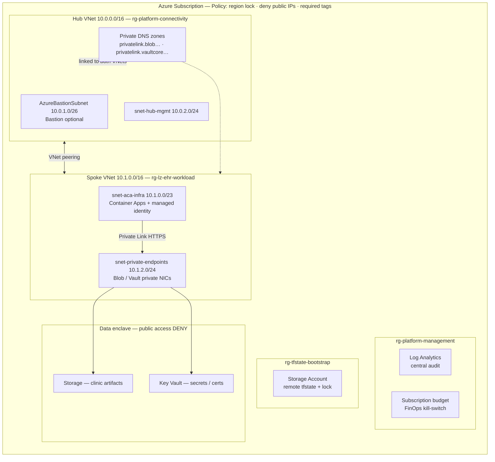

# Azure HIPAA AI Landing Zone

Terraform landing zone for network-isolated Azure workloads that process clinical data. Targets a zero-trust enclave (private endpoints, managed identities, Azure Policy) suitable for hosting clinical AI apps such as an EHR migration engine.

> **Scope.** This repository provisions infrastructure guardrails. HIPAA compliance also requires a Microsoft BAA, organizational policies, access reviews, and application-level controls—those are out of band here.

---

## Contents

- [Design goals](#design-goals)
- [Architecture](#architecture)
- [Security model](#security-model)
- [Repository layout](#repository-layout)
- [Prerequisites](#prerequisites)
- [Quick start (dev)](#quick-start-dev)
- [Environments](#environments)
- [Make targets](#make-targets)
- [Cost model (dev lab)](#cost-model-dev-lab)
- [Verification](#verification)
- [CI/CD](#cicd)

---

## Design goals

Default Azure PaaS endpoints and shared networking are unsuitable for PHI. This landing zone enforces:

| Control | Behavior |
| --- | --- |
| No public data plane | Storage, Key Vault, and workload ingress reject public internet traffic |
| Private Link | App ↔ storage/Key Vault traffic stays on VNet private IPs |
| Passwordless auth | User-assigned managed identity + data-plane RBAC; no connection strings in code |
| Policy guardrails | Deny public IPs, restrict region (e.g. `centralindia`), require cost-center tags |
| Ephemeral lab | Dev defaults to scale-to-zero and Bastion off; destroy path returns spend to ~$0/hr |

---

## Architecture



### Subnet plan

Azure reserves 5 IPs per subnet. Sizes below follow service minimums (Bastion `/26`, ACA delegation).

| Subnet | VNet | CIDR | Usable (approx.) | Notes |
| --- | --- | --- | --- | --- |
| `AzureBastionSubnet` | Hub `10.0.0.0/16` | `10.0.1.0/26` | 59 | Name and `/26` minimum are Azure-mandated |
| `snet-hub-mgmt` | Hub | `10.0.2.0/24` | 251 | Ops / jump hosts |
| `snet-aca-infra` | Spoke `10.1.0.0/16` | `10.1.0.0/23` | 507 | Delegated to `Microsoft.App/environments` |
| `snet-private-endpoints` | Spoke | `10.1.2.0/24` | 251 | Private NICs for Storage and Key Vault |

### Deploy order

Modules compose as a DAG (outputs → inputs):

1. **bootstrap** — remote state storage (one-time, ~$0.02/mo)
2. **governance** — resource groups, budget, Azure Policy
3. **networking-hub-spoke** — hub/spoke, peering, NSGs, private DNS, optional Bastion
4. **data-enclave** — locked Storage + Key Vault + private endpoints
5. **workload-aca** — Log Analytics, managed identity, RBAC, VNet-injected Container App

---

## Security model

### Private endpoints and DNS

With public network access disabled on Storage, public clients receive `403`. In-VNet resolution works as follows:

1. A private endpoint places a NIC (e.g. `10.1.2.4`) in `snet-private-endpoints`.
2. Private DNS (`privatelink.blob.core.windows.net`) answers the public FQDN with that private IP.
3. TLS hostnames stay valid; app code does not change; data stays on the VNet.

### Managed identity and RBAC

No storage keys or connection strings in environment variables:

1. Terraform creates a user-assigned managed identity.
2. Data-plane roles are granted (typical):
   - `Storage Blob Data Contributor` on the Storage Account
   - `Key Vault Secrets User` on the Key Vault
3. The identity is attached to the Container App at deploy time.

---

## Repository layout

```text
.
├── bootstrap/                 # Remote Terraform state (Azure Storage)
├── modules/
│   ├── governance/            # RGs, budget, policy
│   ├── networking-hub-spoke/  # Hub/spoke, DNS, Bastion flag
│   ├── data-enclave/          # Storage, Key Vault, private endpoints
│   └── workload-aca/          # Identity, RBAC, Container Apps
├── environments/
│   ├── dev/                   # Ephemeral lab (scale-to-zero, Bastion off)
│   └── prod/                  # Hardened (GRS, locks, Bastion as required)
├── scripts/
│   └── verify-zero-trust.sh   # External checks that public access is denied
├── .github/workflows/         # Validate/scan + nightly FinOps destroy
└── Makefile                   # fmt, validate, lifecycle, verify
```

---

## Prerequisites

| Tool | Purpose |
| --- | --- |
| [Azure CLI](https://learn.microsoft.com/cli/azure/install-azure-cli) | Auth and subscription context (`az login`) |
| [Terraform](https://developer.hashicorp.com/terraform/install) ≥ 1.5 | Provisioning |
| [Checkov](https://www.checkov.io/) | Local / CI static analysis (`make sec-scan`) |
| Make | Lifecycle targets |
| Contributor (or equivalent) on the target subscription | Apply permissions |

Authenticate before any apply:

```bash
az login
az account set --subscription "<subscription-id>"
```

---

## Quick start (dev)

```bash
# One-time: remote state backend
make bootstrap-init && make bootstrap-apply

# Lab session (~3 min apply; keep Bastion off unless needed)
make dev-init
make dev-plan    # review
make dev-up

# Prove public data-plane access is blocked
make verify

# Optional: Bastion for short SSH/tunnel windows (~$0.19/hr)
make dev-bastion-up

# End of day: destroy billable resources
make dev-down
```

Run `make` (or `make help`) for the full target list.

---

## Environments

| Env | Intent | Typical defaults |
| --- | --- | --- |
| `dev` | Short-lived lab / demos | Consumption ACA (`min_replicas = 0`), `deploy_bastion = false` |
| `prod` | Persistent enclave | Geo-redundant storage, resource locks, Bastion only if required by ops |

Select environment for validate-style targets with `ENV`:

```bash
make validate ENV=prod
```

---

## Make targets

| Target | Description |
| --- | --- |
| `help` | List targets (default goal) |
| `fmt` | `terraform fmt -recursive` |
| `validate` | Init (no backend) + validate for `ENV` |
| `sec-scan` | Checkov against Terraform |
| `bootstrap-init` / `bootstrap-apply` | Create remote state storage |
| `dev-init` / `dev-plan` / `dev-up` | Dev lifecycle |
| `dev-bastion-up` | Enable Bastion for active testing |
| `dev-down` | Destroy dev |
| `verify` | Zero-trust external isolation checks |

---

## Cost model (dev lab)

Designed for a multi-week study sprint at low spend when destroyed between sessions:

- **~$0 control plane:** VNets, NSGs, Policy, RBAC; Log Analytics under free tier limits
- **~$0 idle compute:** Container Apps Consumption with `min_replicas = 0`
- **Bastion off by default:** enable only for active troubleshooting
- **Nightly destroy workflow:** intended safety net against forgotten lab stacks (see CI/CD)

Always confirm current Azure pricing for your region and SKUs before relying on estimates.

---

## Verification

`make verify` runs `scripts/verify-zero-trust.sh` against deployed endpoints and expects public access to fail (e.g. HTTP `403` / connection refused). Treat a passing verify as a necessary network check, not a full compliance attestation.

---

## CI/CD

| Workflow | Role |
| --- | --- |
| `ci-validate-sec.yml` | Format/validate + Checkov on pull requests |
| `nightly-finops-destroy.yml` | Tear down idle `dev` resources to cap spend |

Wire repository secrets / OIDC federated credentials for Azure before enabling apply or destroy jobs in CI.

---

## Disclaimer

This repository is infrastructure tooling. It does not constitute legal advice or a certified HIPAA compliance program. Engage your security, privacy, and legal stakeholders before processing PHI in any environment provisioned from this code.
